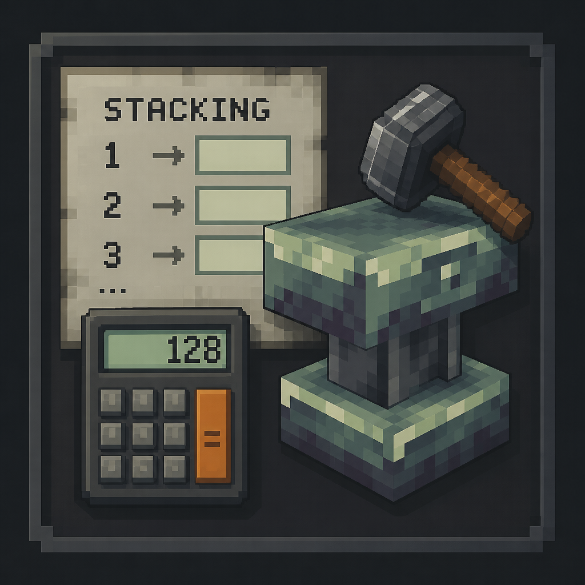

<div align="center">



# AnvilCraft Stack Calculator

</div>

《铁砧工艺》方块最密堆积计算器。它为以下结构按各自衰变规则计算布局，并尽量减少昂贵的隔离材料：

- 虚空物质块、负物质块与虚空能收集器。
- 钚块、浮冰与集热器。

支持不堆积、平面堆积和立体堆积，提供真实方块模型的 Three.js 预览、X/Y/Z 分层视图、材料统计和坐标复制。

界面默认跟随系统的深浅色设置。右上角的主题按钮可切换模式，浏览器会记住选择。

## 当前规则

- 基础单元为 `5 x 5 x 5`，中心坐标放置设备。
- 邻接只计算六个正交方向。虚空发电按服务器默认的 `world.voidMatterDecayThreshold = 5` 计算。有五个或更多同类邻面的虚空物质块会在随机刻衰变。
- 每个钚块至少要有一个面接触冰标签方块，或接触含水标签流体的方块，否则会在随机刻融毁为岩浆块。计算器以浮冰表示每个冷却位置，游戏中也可在该处放水或含水方块。
- 三种模式都只计算并展示一个 `5 x 5 x 5` 单元，不需要输入堆积数量。
- 不堆积模式按独立边界求解；平面模式生成可沿 X/Z 复制的周期单元；立体模式生成可沿 X/Y/Z 复制的周期单元。
- 建造有限的钚块阵列时，若最外侧钚块依靠相邻单元的浮冰冷却，需要在它的裸露面紧贴补一块浮冰。材料统计仅覆盖单元内部。
- 虚空场景已证明最优的每单元结果依次为：不堆积 `110/14/1`、平面 `93/31/1`、立体 `90/34/1`（主材料/隔离材料/设备）。
- 钚块集热的最优方案按钚块 / 浮冰 / 集热器列出：不堆积 `98/26/1`、平面 `101/23/1`、立体 `104/20/1`。三种模式的单元内浮冰数量均已证明最少。
- 每个预计算单元在 Worker 中由独立验证器复核。只有上下界一致时才显示“已证明最优”。

2026-11-22 核对了 Minecraft 1.21.1 / AnvilCraft 1.6.0 开发分支的提交 `6a4cde43b`。[虚空物质衰变判定](https://github.com/Anvil-Dev/AnvilCraft/blob/6a4cde43b4ece65b765137a7aab145b9b4c002bf/src/main/java/dev/dubhe/anvilcraft/block/VoidMatterBlock.java) · [默认衰变阈值](https://github.com/Anvil-Dev/AnvilCraft/blob/6a4cde43b4ece65b765137a7aab145b9b4c002bf/src/main/java/dev/dubhe/anvilcraft/config/AnvilCraftServerConfig.java) · [钚块冷却判定](https://github.com/Anvil-Dev/AnvilCraft/blob/6a4cde43b4ece65b765137a7aab145b9b4c002bf/src/main/java/dev/dubhe/anvilcraft/block/RadioactiveBlock.java)

## 开发

需要 Node.js 和 pnpm。

```bash
pnpm install
pnpm dev
```

默认开发地址为 `http://localhost:5173/`。

## 部署

线上地址：[https://anvil-dev.github.io/anvilcraft-stack-calculator/](https://anvil-dev.github.io/anvilcraft-stack-calculator/)

推送到 `main` 分支会触发 GitHub Actions，在测试通过后构建并部署到 GitHub Pages。首次部署前，需要在仓库的 **Settings > Pages > Build and deployment** 中将 Source 设置为 **GitHub Actions**；也可以在 Actions 页面手动运行部署工作流。

## 验证

```bash
pnpm test:run
pnpm build
pnpm test:e2e
```

浏览器端到端检查使用 Playwright：

```bash
pnpm exec playwright install chromium
```

## 许可证

项目代码采用 LGPL-3.0-only。AnvilCraft 和 Minecraft 模型与纹理的许可信息见 [ASSETS_LICENSE](./ASSETS_LICENSE)。
